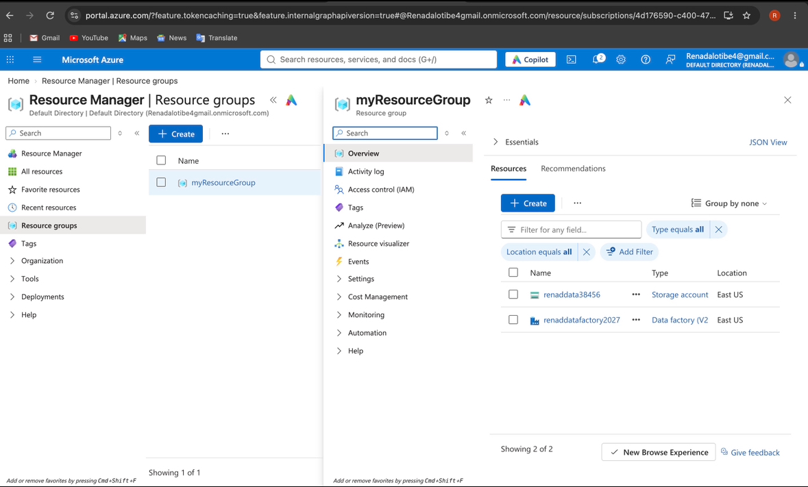
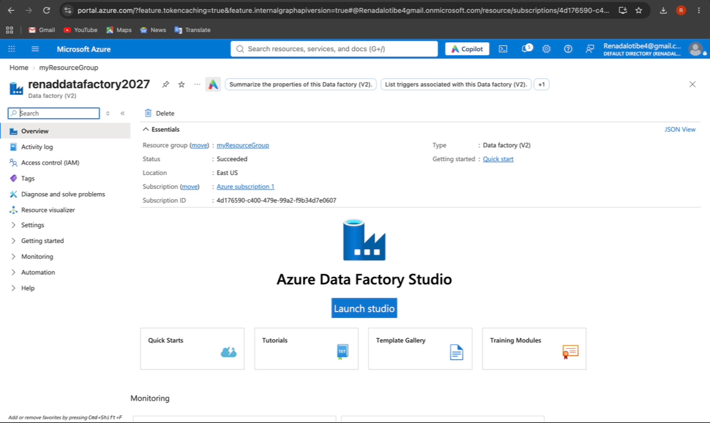
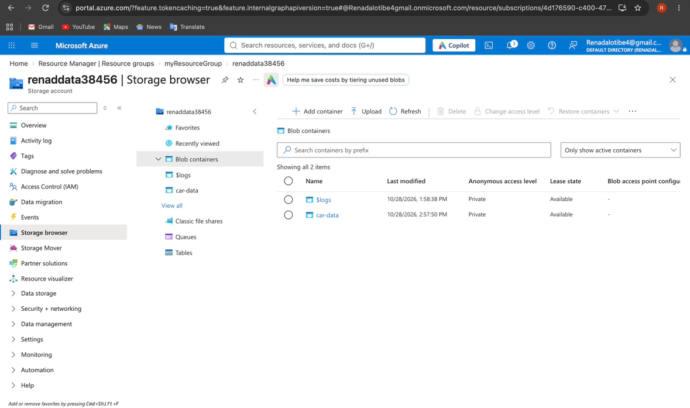
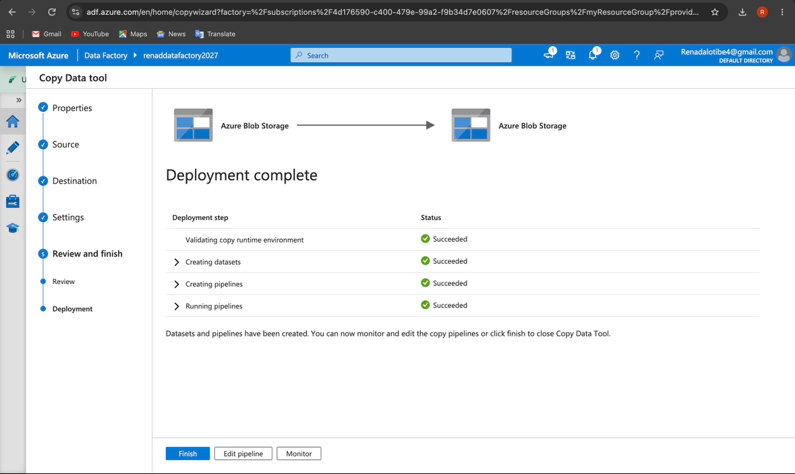
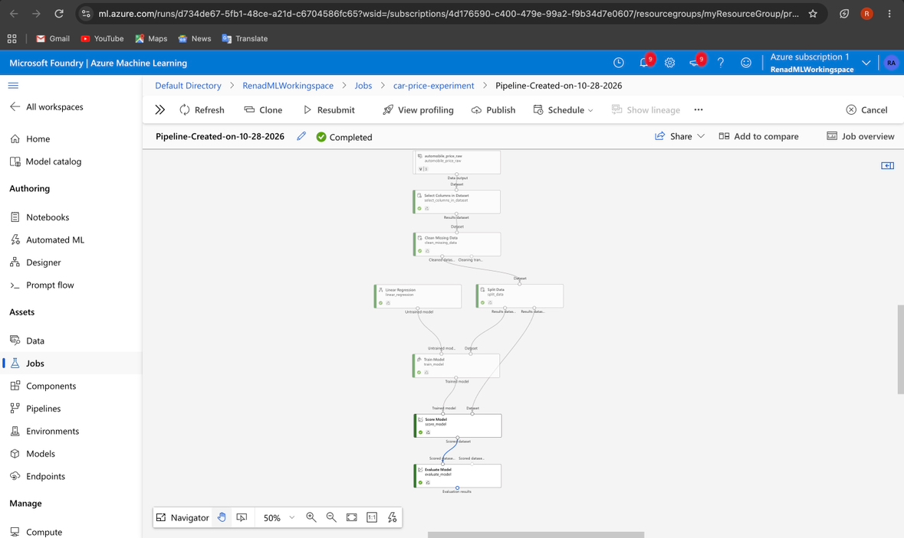
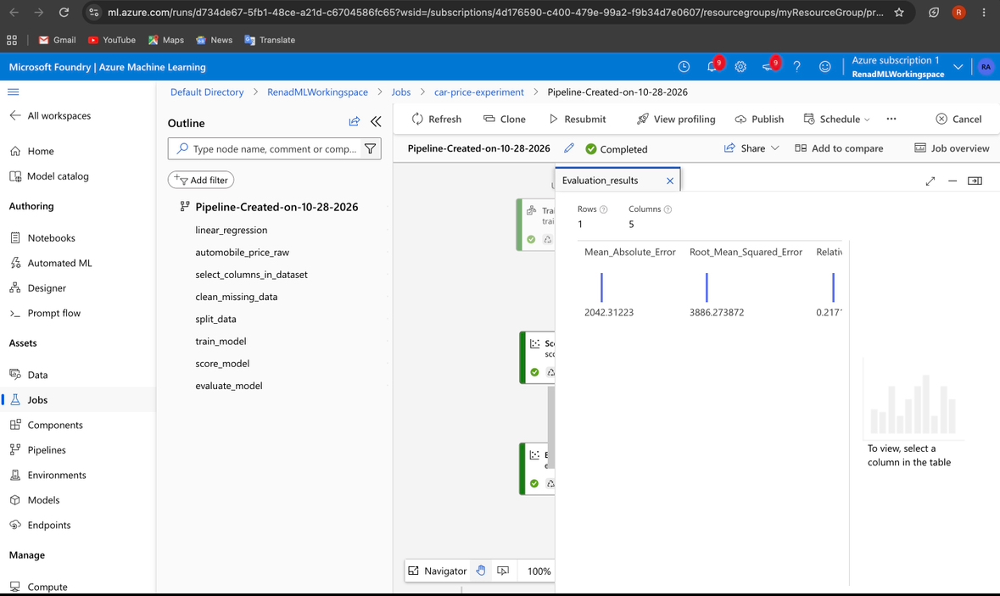
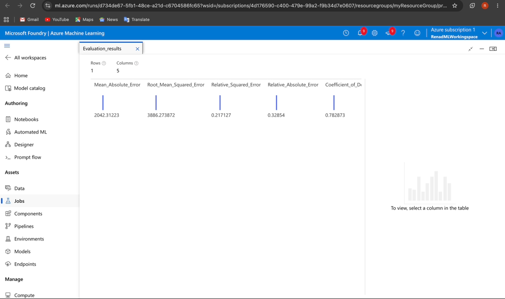
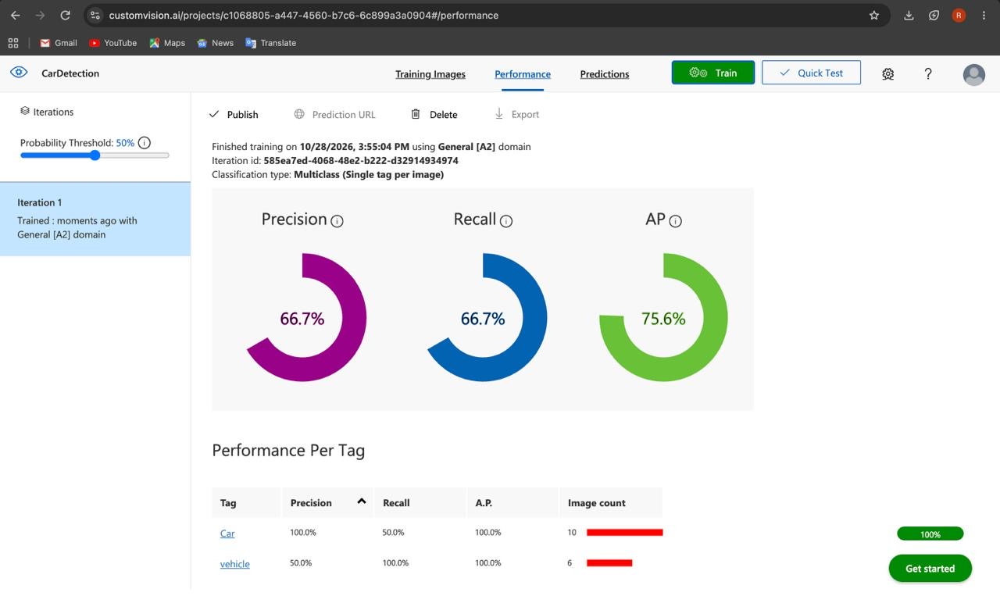

# Azure Cloud & AI Projects

Hands-on projects using Microsoft Azure, covering cloud infrastructure, data engineering, machine learning, and computer vision.

## Overview

This repository showcases practical experience with Microsoft Azure cloud services through three projects:

•⁠  ⁠*Azure Data Factory* – Cloud data storage and data pipeline implementation.
•⁠  ⁠*Azure Machine Learning* – Car price prediction using Linear Regression.
•⁠  ⁠*Azure Custom Vision* – Image classification for cars and vehicles.

## Technologies & Tools

•⁠  ⁠Microsoft Azure
•⁠  ⁠Azure Data Factory
•⁠  ⁠Azure Blob Storage
•⁠  ⁠Azure Machine Learning
•⁠  ⁠Azure Custom Vision
•⁠  ⁠Linear Regression
•⁠  ⁠Data Pipelines

---

## 1. Azure Data Factory & Cloud Storage

Configured Azure cloud resources, created a storage account, and implemented a data copying pipeline using Azure Data Factory.

### Azure Resources

Created a resource group containing Azure Data Factory and a Storage Account.

### Data Factory

Successfully deployed and configured Azure Data Factory.

### Blob Storage

Configured Azure Blob Storage containers for cloud data management.

### Data Pipeline

Created and successfully executed a data copying pipeline using Azure Data Factory.

---

## 2. Azure Machine Learning – Car Price Prediction

Developed and evaluated a machine learning pipeline using Azure Machine Learning Designer to predict automobile prices.

### Model Development

•⁠  ⁠Imported automobile price data.
•⁠  ⁠Selected relevant features.
•⁠  ⁠Cleaned missing values.
•⁠  ⁠Split the dataset into training and testing sets.
•⁠  ⁠Trained a Linear Regression model.
•⁠  ⁠Evaluated the model's performance.

### Machine Learning Pipeline

### Model Training

Successfully completed the machine learning pipeline.

### Model Evaluation

The trained model achieved the following results:

| Metric | Result |
|--------|--------|
| Mean Absolute Error (MAE) | 2042.31 |
| Root Mean Squared Error (RMSE) | 3886.27 |
| Relative Squared Error | 0.2171 |
| Relative Absolute Error | 0.3285 |
| R² Score | 0.7829 |

---

## 3. Azure Custom Vision – Image Classification

Created and trained an image classification model using Azure Custom Vision to classify images into car and vehicle categories.

### Implementation

•⁠  ⁠Created a Custom Vision classification project.
•⁠  ⁠Uploaded and labeled training images.
•⁠  ⁠Trained a multiclass classification model.
•⁠  ⁠Evaluated model performance.

### Model Performance

| Metric | Result |
|--------|--------|
| Precision | 66.7% |
| Recall | 66.7% |
| Average Precision (AP) | 75.6% |

---

## Skills Demonstrated

•⁠  ⁠Cloud Resource Management
•⁠  ⁠Cloud Data Storage
•⁠  ⁠Data Engineering
•⁠  ⁠ETL Pipeline Development
•⁠  ⁠Machine Learning
•⁠  ⁠Model Training & Evaluation
•⁠  ⁠Computer Vision
•⁠  ⁠Microsoft Azure Services

---

## Project Information

*Platform:* Microsoft Azure  
*Project Type:* Academic / Hands-on Cloud & AI Projects  
*Focus:* Cloud Computing, Data Engineering, and Artificial Intelligence
